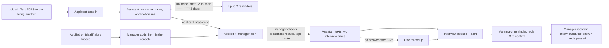

# Hiring Line

A text-to-apply hiring assistant for the dealership, separate from the TextDrive
sales assistant: its own number, its own database, its own console, its own
persona (default name "Jordan", set with `ASSISTANT_NAME`).

The goal is more interviews: more applicants, because texting JOBS is easier
than a long form, and more of them actually sitting down, through fast
replies, reminders, two-time interview offers, and an interview-day reminder.

## How it works



- **The assistant never decides who gets an interview.** It can't book until the
  manager taps Invite (enforced in code). The manager reviews IdealTraits first.
- After the interview, or if the manager pauses it, the assistant stops
  auto-replying and relays texts to the manager.
- If the manager texts an applicant from the console, the assistant stays quiet
  for `COPILOT_COOLDOWN_MIN` and relays anything that comes in meanwhile.

## Setup

1. **Buy a new Twilio number** for hiring. Don't reuse the TextDrive number: one
   number can only point at one app.
2. **Register an A2P 10DLC campaign** for it (see the checklist below). Twilio won't
   reliably deliver unregistered traffic.
3. **Deploy on Railway** as its own service: Root Directory `hiring`, a volume mounted
   at `/app/data` with `DB_PATH=/app/data/hiring.db`, and the variables in
   `.env.example`. The healthcheck is `/health`.
4. In Twilio, point the number's messaging webhook to
   `https://<your-app>/webhooks/twilio/sms` and voice to `/webhooks/twilio/voice`.
5. Open `https://<your-app>/admin/`, enter `ADMIN_TOKEN`, and fill in **Setup**:
   the IdealTraits application link, role, interviewer, interview hours, and job facts.
   The assistant shares only what the job facts say.
6. Put "Text JOBS to (your hiring number). Msg & data rates may apply. Reply STOP to
   opt out." in every job ad and on a lot sign.

## A2P 10DLC checklist (the hiring number)

- Use case: recruiting / job-applicant messages (application link, questions,
  interview scheduling and reminders).
- Opt-in, both paths: (1) the applicant texts JOBS to the number after seeing the
  ad; (2) the applicant gave their mobile number on a job application. Confirm the
  IdealTraits application's consent wording covers texts from the dealership.
- Program page: `https://<your-app>/` shows the call to action and disclosures.
  Privacy and terms are at `/privacy` and `/terms`.
- Sample messages: copy from the reminder templates in `src/jobs.js`.

## Compliance built in

- STOP / START / HELP / AYUDA, plus opt-outs in plain English or Spanish.
- Proactive texts only 8 AM-9 PM in the applicant's local time (Florida 8 PM),
  and at most 2 per applicant per 24 hours.
- Manually added applicants require an "applied and gave us this number"
  attestation, stored as the consent record.
- Fair-hiring guardrails in the prompt: no evaluating, no protected-class or
  screening questions, honest about being AI if asked.
- Discord alerts strip names, phones, and emails.

## Development

```
npm install
cp .env.example .env   # fill in what you have; Twilio can stay blank (texts are logged)
npm run dev            # http://localhost:3000/admin/
npm test               # syntax + env check, then 46 free assertions (no API calls)
```

## Not built yet

- Automatic deletion of old applicant messages. Employment record-keeping rules
  (EEOC: generally 1 year) need a decision first.
- IdealTraits integration. Applicants from IdealTraits are added by hand.
- Hiring stats beyond the console's funnel.
